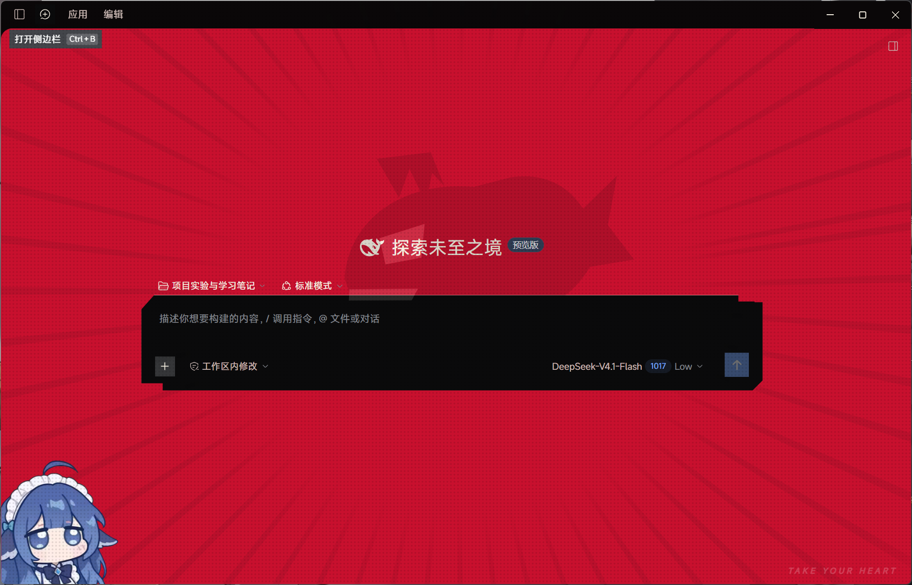
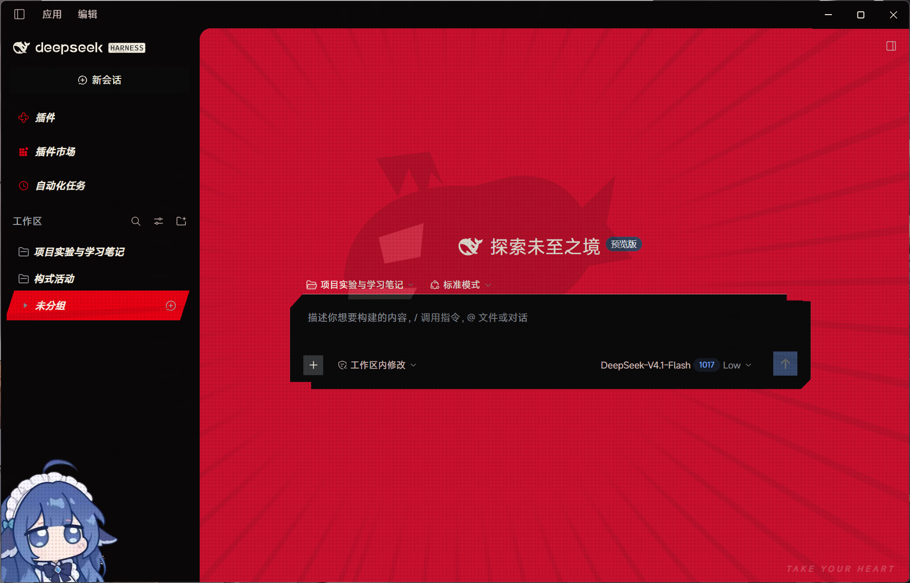

# dsh-theme-p5r

粉丝向的Persona 5 Royal 风格的 DeepSeek Harness 桌面版 主题插件喵。

没有改什么特别的东西，只是修改了背景和一些动态效果，主体就是红黑配色喵

背景上怪盗鱼形象是deepseek自己绘制的喵，就是大肥鱼眼中的自己喵

## 效果

| 部分 | 做法 |
| --- | --- |
| 全站配色 | `theme.overrideTokens` 覆盖 DSH 的 17 个 `--dsw-alias-*` 令牌（亮/暗两套） |
| 圆角 | 全部归零，印刷感 |
| 标题与强调 | 900 字重 + 斜体 + 负字距 |
| 交互 | hover 反色成红块、选中项左侧红色竖脊、红色焦点环、红底白字选区 |
| 背景 | 半调网点（纯 CSS 径向渐变，无图片） |
| 水印 | 自绘的**怪盗鲸鱼**标（内联 SVG）+ 右下角 `TAKE YOUR HEART` 斜体字 |
| 滚动条 | 方形、悬停变红 |

亮色 / 暗色跟随系统或应用内的外观设置，无需手动切换。

> 那个鲸鱼标是本项目自己的标识，用扁平黑剪影 + 白色眼睛和下颌缺口画的，和 DSH 的鱼形 logo 呼应，不是任何游戏 logo 的临摹。

## 安装

从 GitHub 装（推荐，会随仓库更新）：

```bash
dsh plugin --profile desktop add github:renge1145141919810/dsh-p5r-theme
```

或者本地目录装（开发时用，改完刷新页面就生效）：

```bash
dsh plugin --profile desktop add /path/to/dsh-theme-p5r
```

装完**刷新页面**（`Ctrl+R`）；改过 `index.js` 则要整进程重启 DSH。

卸载：

```bash
dsh plugin --profile desktop rm dsh-theme-p5r
```

也可以在「设置 › 插件」里停用。**插件存在即生效**，没有单独的开关——停用/卸载就等于恢复原生外观。

## 结构

```
client.js          主题本体：令牌覆盖 + 一段 body[data-p5r] 作用域的样式表
index.js           Host 半：空实现（插件行需要它）
cordis.patch.yml   bundle patch：插入 theme-p5r 一行
locale/zh.json     插件卡片文案（中文）
locale/en.json     插件卡片文案（英文）
icon.svg           自绘图标（蒙面 + 红斜带）
```

## 预览图





